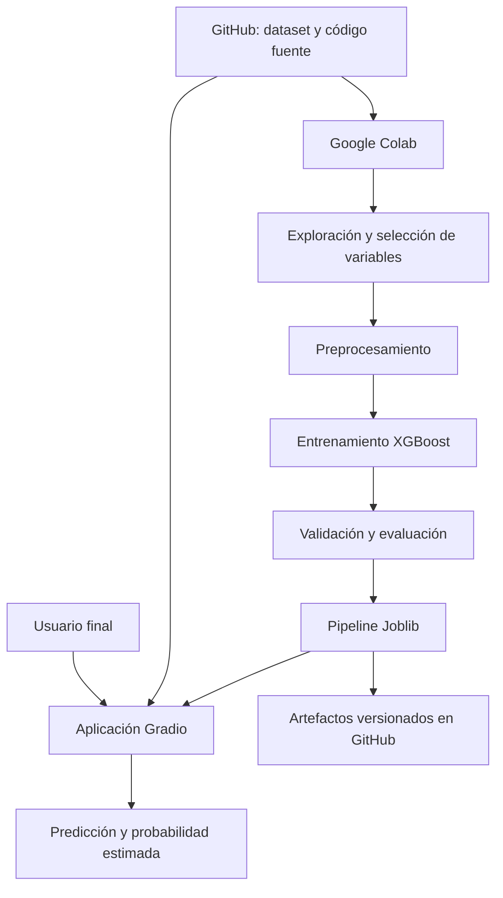

# LogistiX AI — G4 | Prototipo 1

## Sistema predictivo de errores de packing

Evaluación N.º 4 — Inteligencia Artificial  
Ingeniería en Informática | INACAP  
Grupo 4 | 2026

[](https://colab.research.google.com/github/acronimoo/logistix-ai-g4/blob/main/LogistiX_G4_Prototipo1/LogistiX_G4/LogistiX_Entrenamiento.ipynb)

## 1. Descripción del proyecto

LogistiX es una empresa de logística y distribución que presenta errores durante la preparación de pedidos.

Este proyecto implementa un prototipo de inteligencia artificial mediante XGBoost, capaz de generar alertas de riesgo antes de iniciar el proceso de packing.

La solución permite ingresar las características de un pedido mediante una interfaz web desarrollada con Gradio y obtener:

- Clasificación binaria: Sí/No.
- Probabilidad estimada de error.
- Probabilidad estimada sin error.
- Recomendación de revisión del pedido.
- Validación de los datos ingresados.

La predicción de entregas atrasadas no forma parte del alcance.

## 2. Objetivo general

Desarrollar un prototipo predictivo que permita identificar el riesgo de errores durante la preparación de pedidos, utilizando técnicas de Machine Learning y prácticas de gestión del ciclo de vida del modelo mediante MLOps.

## 3. Tecnologías utilizadas

| Tecnología | Versión | Propósito |
|---|---|---|
| Python | 3.13.18 | Lenguaje de programación |
| Google Colab | Cloud | Entrenamiento y evaluación |
| Pandas | 2.2.3 | Procesamiento de datos |
| NumPy | 2.4.6 | Operaciones numéricas |
| Scikit-learn | 1.6.1 | Preprocesamiento y evaluación |
| XGBoost | 3.4.1 | Clasificación predictiva |
| Joblib | 1.5.3 | Persistencia del modelo |
| OpenPyXL | 3.1.5 | Lectura de archivos Excel |
| Gradio | 6.5.1 | Interfaz web |
| GitHub | Cloud | Repositorio y versionamiento |

## 4. Dataset

El archivo LogistiX.xlsx fue proporcionado para la evaluación académica.

| Característica | Resultado |
|---|---:|
| Registros | 1200 |
| Columnas originales | 9 |
| Valores nulos | 0 |
| Filas duplicadas | 0 |
| Pedidos sin error | 958 |
| Pedidos con error | 242 |
| Proporción de errores | 20,17 % |

### Variable objetivo

error_preparacion:

- 0: Pedido sin error.
- 1: Pedido con error.

### Variables predictoras

| Variable | Descripción | Rango observado |
|---|---|---|
| unidades | Cantidad de unidades | 1–120 |
| carga_bodega_pct | Porcentaje de carga de bodega | 45–100 |
| stock_disponible | Inventario disponible | 0–250 |
| prioridad | Prioridad del pedido | Normal, Alta, Urgente |

### Variables descartadas

| Variable | Justificación |
|---|---|
| pedido_id | Identificador único del pedido |
| distancia_km | Variable principalmente asociada al transporte |
| tiempo_picking_min | Duración desconocida antes de iniciar la preparación |
| entrega_atrasada | Resultado posterior y objetivo de otro prototipo |

La selección responde al alcance preventivo de la solución y no implica que las variables descartadas carezcan necesariamente de asociación estadística.

## 5. Arquitectura de la solución



## 6. Entrenamiento del modelo

El entrenamiento se realizó en Google Colab utilizando XGBClassifier.

Se aplicó una partición estratificada:

| Conjunto | Porcentaje | Registros |
|---|---:|---:|
| Entrenamiento | 60 % | 720 |
| Validación | 20 % | 240 |
| Prueba | 20 % | 240 |

La variable categórica prioridad se transforma mediante OneHotEncoder.

El preprocesamiento y el clasificador se integran en un Pipeline para mantener la consistencia entre entrenamiento y predicción.

Se utiliza una semilla de 42 para favorecer la reproducibilidad.

El umbral de clasificación de 0,10 se seleccionó mediante F2-Score sobre el conjunto de validación, priorizando la detección de errores.

## 7. Resultados del modelo

Resultados obtenidos en Google Colab sobre el conjunto de prueba.

| Métrica | Resultado |
|---|---:|
| Accuracy | 28,75 % |
| Precision | 20,00 % |
| Recall | 85,42 % |
| F1-Score | 32,41 % |
| F2-Score | 51,64 % |
| ROC-AUC | 0,5103 |
| Average Precision | 0,2443 |
| Umbral de clasificación | 10,00 % |

### Matriz de confusión

| Clase real / Predicción | Sin error | Con error |
|---|---:|---:|
| Sin error | 28 | 164 |
| Con error | 7 | 41 |

El modelo detectó 41 de los 48 errores reales presentes en el conjunto de prueba.

Sin embargo, el elevado número de falsos positivos y el ROC-AUC cercano a 0,5 evidencian una capacidad discriminativa limitada.

Un clasificador que siempre predijera ausencia de error alcanzaría un Accuracy del 80 %, pero no detectaría ningún error.

El prototipo tiene un propósito experimental y académico. No se recomienda utilizarlo como criterio único de decisión operacional.

## 8. Ejecución desde Google Colab

1. Presionar el botón Abrir en Google Colab.
2. Ejecutar la instalación de dependencias.
3. Reiniciar la sesión si Colab lo solicita.
4. Ejecutar las secciones restantes en orden.
5. El dataset se descarga automáticamente desde GitHub.
6. Entrenar y evaluar el modelo.
7. Generar los artefactos del entrenamiento.
8. Ejecutar las pruebas de integración.
9. Ejecutar la última celda para iniciar Gradio.
10. Abrir el enlace público temporal generado.

El enlace de Gradio depende de la sesión de ejecución de Colab y no constituye un alojamiento permanente.

Utilizar únicamente datos de prueba en la demostración pública.

## 9. Ejecución local

Desde la carpeta que contiene app.py, utilizando PowerShell y un entorno Python compatible con las dependencias:

```powershell
py -m venv .venv

.\.venv\Scripts\python.exe -m pip install -r requirements.txt

.\.venv\Scripts\python.exe app.py
```

Abrir en el navegador:

http://127.0.0.1:7860

Para detener el servidor, utilizar Ctrl+C.

La ejecución local debe comprobarse con las versiones actualizadas de las dependencias. El entorno verificado para esta entrega es Google Colab.

## 10. Pruebas funcionales

| ID | Unidades | Carga | Stock | Prioridad | Resultado | Estado |
|---|---:|---:|---:|---|---|---|
| PF-01 | 23 | 94 % | 117 | Alta | Sí, 11,19 % | Aprobado |
| PF-02 | 37 | 71 % | 219 | Urgente | No, 8,79 % | Aprobado |
| PF-03 | 113 | 47 % | 158 | Urgente | Sí, 11,73 % | Aprobado |
| PF-04 | 150 | 47 % | 158 | Urgente | Entrada rechazada | Aprobado |

Las cuatro pruebas funcionales fueron satisfactorias.

La cuarta prueba comprueba que el sistema rechaza cantidades superiores al máximo observado de 120 unidades.

El cumplimiento funcional de estas pruebas no representa la exactitud predictiva del modelo.

### Prueba de integración

Se comparó la predicción obtenida directamente mediante el Pipeline con la predicción generada por la aplicación web.

Resultado:

- Probabilidad del modelo: 11,19 %.
- Probabilidad de la aplicación: 11,19 %.
- Clasificación: Sí.
- Estado: Prueba exitosa.

## 11. Gestión del ciclo de vida — MLOps

### Prácticas implementadas

- Control de versiones mediante GitHub.
- Entrenamiento reproducible mediante Google Colab.
- Registro de versiones de dependencias.
- Separación de entrenamiento, validación y prueba.
- Persistencia del modelo y preprocesamiento.
- Registro de métricas de evaluación.
- Identificación del dataset mediante SHA-256.
- Validación de entradas.
- Pruebas funcionales y de integración.
- Versionamiento de artefactos del modelo.

### Prácticas propuestas para producción

- Automatización CI/CD.
- Monitoreo de rendimiento predictivo.
- Detección de Data Drift.
- Registro de errores reales de packing.
- Reentrenamiento periódico.
- Control de acceso.
- Validación de nuevas versiones antes de desplegar.
- Rollback del modelo.

Estas prácticas propuestas no se encuentran implementadas en el alcance actual.

## 12. Limitaciones

### Limitación 1: capacidad predictiva reducida

El ROC-AUC de 0,5103 evidencia una capacidad discriminativa cercana al azar.

Aunque el umbral permite detectar una proporción elevada de errores, también genera numerosas falsas alertas, lo que podría aumentar la carga de revisión operacional.

Las probabilidades estimadas no han sido calibradas.

### Limitación 2: disponibilidad de datos

El dataset posee 1200 registros y no incluye variables relevantes como experiencia del preparador, complejidad del pedido, cantidad de SKU diferentes, turno laboral o historial temporal.

Esto limita la generalización del modelo y la posibilidad de validar su comportamiento en distintos períodos y bodegas.

## 13. Estructura del proyecto

```text
LogistiX_G4/
├── LogistiX_Entrenamiento.ipynb
├── LogistiX.xlsx
├── app.py
├── entrenar.py
├── test_app.py
├── requirements.txt
├── README.md
└── artefactos/
    ├── pipeline.joblib
    ├── metricas.json
    └── esquema.json
```

## 14. Referencias

- XGBoost: https://xgboost.readthedocs.io/
- Scikit-learn: https://scikit-learn.org/stable/
- Gradio: https://www.gradio.app/docs
- Google Colab: https://colab.research.google.com/
- GitHub: https://docs.github.com/
- Pauta Evaluación N.º 4 de Inteligencia Artificial, INACAP.
- Dataset LogistiX.xlsx proporcionado para la evaluación.

---

Proyecto académico — Grupo 4  
Ingeniería en Informática | INACAP | 2026  
Versión del modelo: 1.0.0
